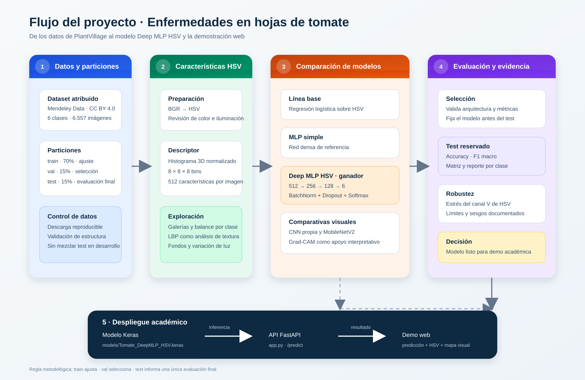
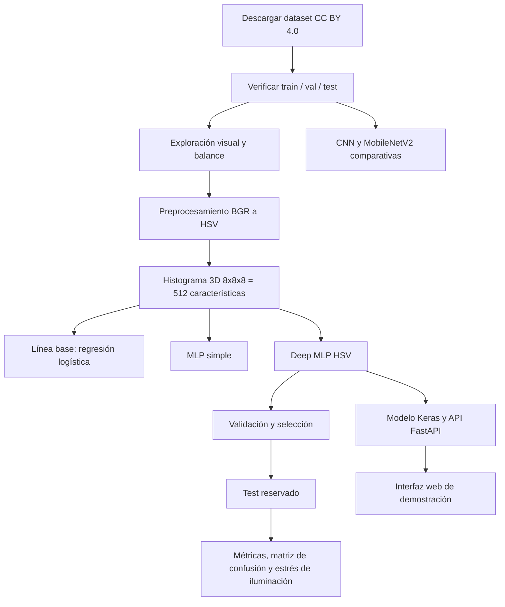

# Flujo del proyecto

La imagen muestra las etapas, los modelos comparados, el uso separado de `train`, `val` y `test`, y la ruta de despliegue del modelo final. Mermaid se conserva debajo como fuente editable.

## Reglas de evaluación

- `train`: ajuste de parámetros y aumento de datos.
- `val`: selección de arquitectura y seguimiento durante el desarrollo.
- `test`: una sola evaluación final, sin ajustar decisiones posteriores.
- El flujo no sustituye la validación agronómica en campo.
